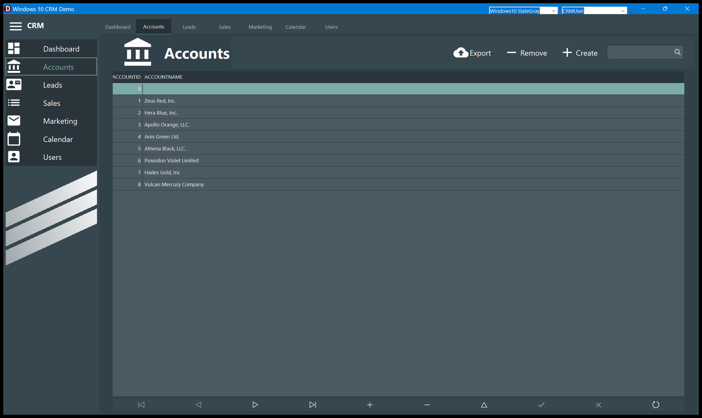

# Accounts

The companies your leads belong to. An account is little more than a name: its job is to be
picked in the **Account Name** box of a [lead](Lead-Detail.md), and to be printed as the
"Bill To" of a [proposal](Draft-Proposal.md).

The list has two columns, **AccountId** (assigned by the database, you cannot type it) and
**AccountName**, and the second one always stretches to fill the window.

Unlike leads and proposals, accounts are **not** filtered by the active user: everybody sees
the same list.

## Create

**Create** asks for the name in a small dialog that starts out filled with `New Account`,
then appends the row. The name is not checked: you can create two accounts with the same
name, or one with an empty name, and nothing will complain.

> The sample data already contains one account with an empty name and id 0 — it comes with
> the demo, it is not something you did.

## Remove

**Remove** deletes the selected row immediately, **without asking**. There is no undo.

Nothing stops you from removing an account that leads are pointing at: the leads keep the
name they had stored, and the box in their detail window will show a name that is no longer
in the list.

## Search

The **Search** box filters as you type, on the account name only, ignoring upper and lower
case, matching anywhere in the name — typing `or` finds both *Apollo Orange, LLC.* and
*Vulcan Mercury Company*. Clear the box to see everything again.

## Export

**Export** saves the whole table — not the filtered list — to a file you choose. The format
is FireDAC's own (binary, XML or JSON according to the extension you give it), which the same
application can read back; it is not a spreadsheet file. For something you can open in Excel,
use the export on the [Marketing](Marketing.md) page, which writes a delimited text file.

## The navigator at the bottom

The row of arrows under the list moves the selection, and the `+`, `−` and `✓` buttons insert,
delete and post a row directly in the grid. They work on the same table the buttons above use,
so a row inserted here is an account like any other.
