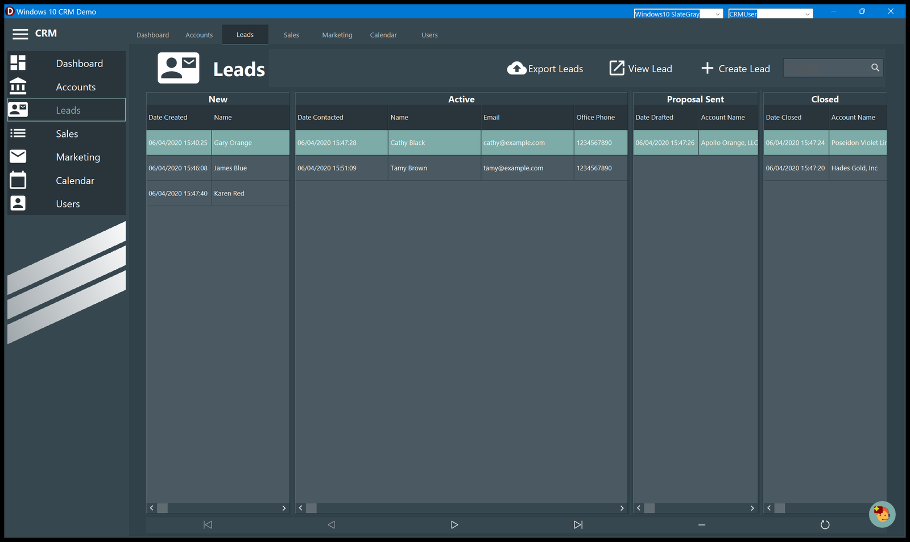
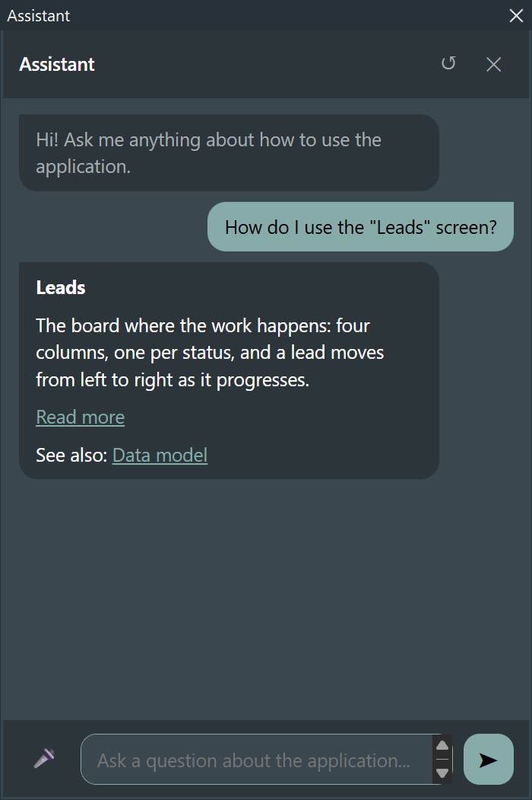
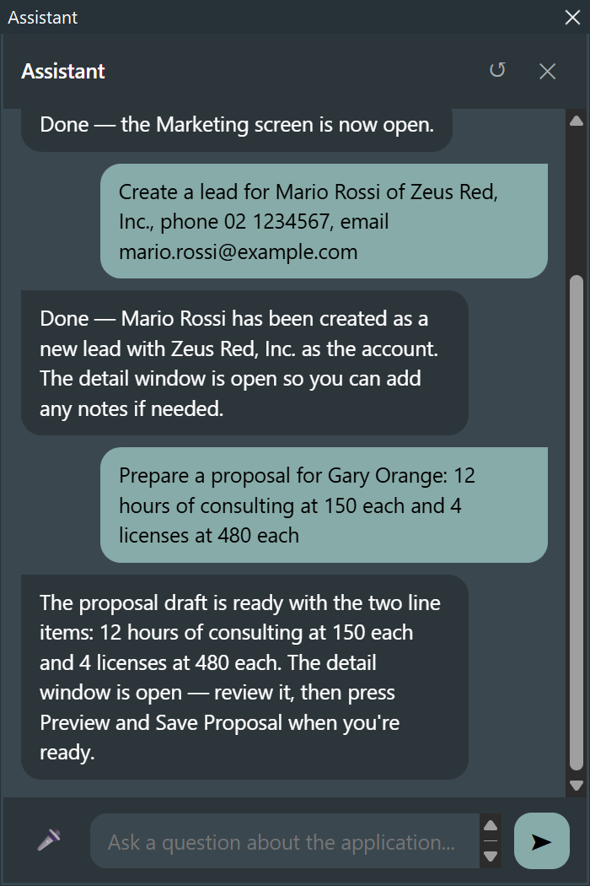
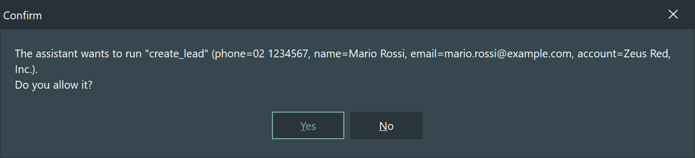
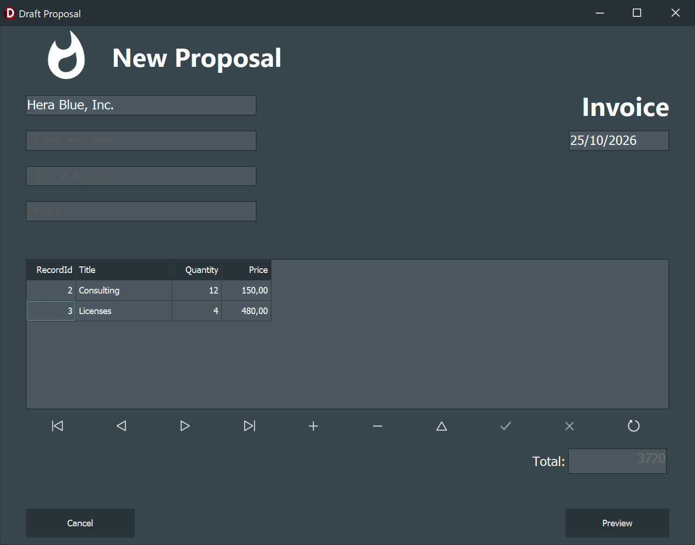

# Asking the assistant

The application carries this manual inside it, and an assistant that has read it. Instead of
looking a page up, you can ask — and for a few things, you can ask it to do the work.



## Two ways to open it

**Press F1.** The assistant opens already asking about the screen you are on: on the Leads
board it asks about Leads, on Marketing about Marketing, and so on. It works from anywhere —
inside a list, on a button, in the side menu.

**Click the round button** in the bottom right corner. That opens the assistant with no
question: use it when what you want to know has nothing to do with where you are.

## Asking a question



Type in the box at the bottom — *"how do I export the mailing list"*, *"what happens if I
remove a user"* — and press Enter. The answer comes from the pages of this manual: the
assistant is told to stay inside them, to cite the page it used, and to say when it does not
know rather than invent. **Read more** opens the whole page inside the assistant.

The conversation stays as you move around the application, and the ↻ button at the top
clears it.

## Asking it to do things



Three things the assistant can do in this application, and nothing else:

| Ask for | What happens |
| - | - |
| *"open the Marketing screen"* | It switches to that screen |
| *"create a lead for Mario Rossi of Zeus Red, Inc., phone 02 1234567, email mario.rossi@example.com"* | It creates the lead with status **New** and opens its detail window |
| *"prepare a proposal for Gary Orange: 12 hours of consulting at 150 each and 4 licenses at 480 each"* | It opens the proposal draft with the customer and the line items already in, total included |

### It asks before it writes

Anything that changes data stops and asks first, showing exactly what it is about to do:



Answer **No** and nothing happens; the assistant is told you refused and says so. Only
*open the screen* goes ahead without asking, because it changes nothing.

### It prepares, you decide



Notice what the proposal action does **not** do: it fills the draft and leaves it open. The
total is computed, the window is in front of you, and **Preview** and **Save Proposal** are
still yours to press. The same with a new lead: it is created, its window opens, and
correcting what the assistant understood is a normal edit.

## What it sends, and where

The assistant uses Anthropic's Claude, so the question you type, the name of the screen you
are on, the excerpts of this manual that look relevant and the outcome of any action it runs
leave your machine and reach Anthropic's service. **The content of your database does not**:
the leads, the accounts, the proposals and the attached documents stay where they are, and
the assistant cannot read them. Ask it how many leads you have and it will tell you to look
at the [Dashboard](Dashboard.md).

It needs an API key, in `helpchatai.json` in the `HelpChatAI` folder of your user profile
(`%APPDATA%\HelpChatAI`):

```json
{ "Claude": { "ApiKey": "sk-ant-..." } }
```

Without it the assistant opens and answers that the key is missing. Everything else in the
application works as always — the assistant is help, not a requirement.

## When it does not know

If no page fits, it says so rather than inventing an answer. Two things usually help: ask with
the words the application uses on screen (*proposal*, *lead*, *account*), and ask one thing at
a time.
