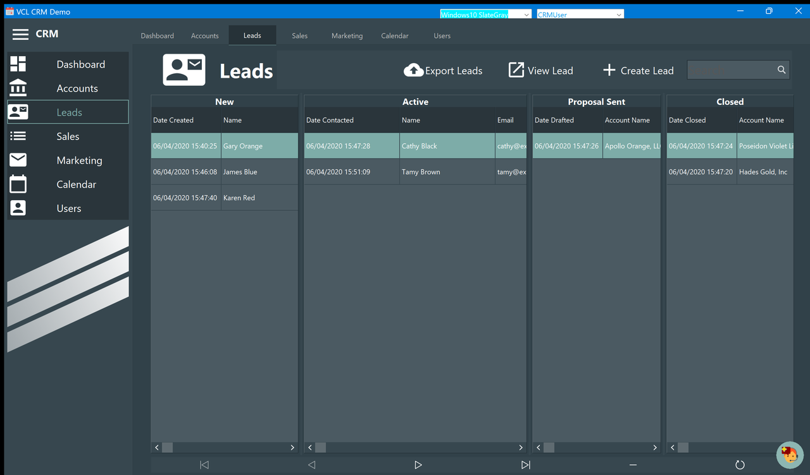
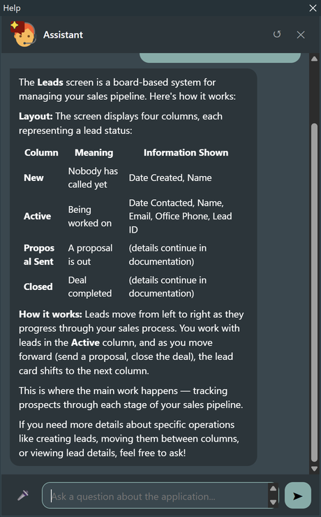
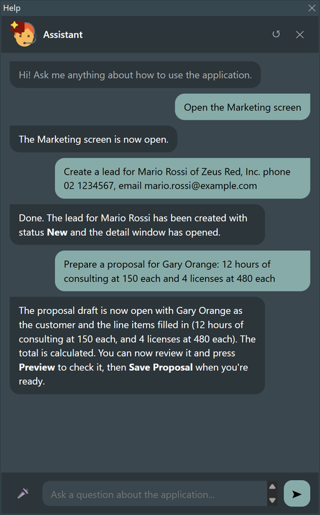
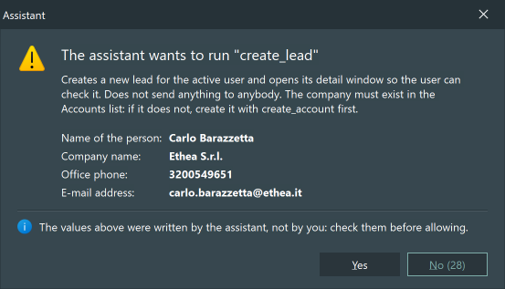
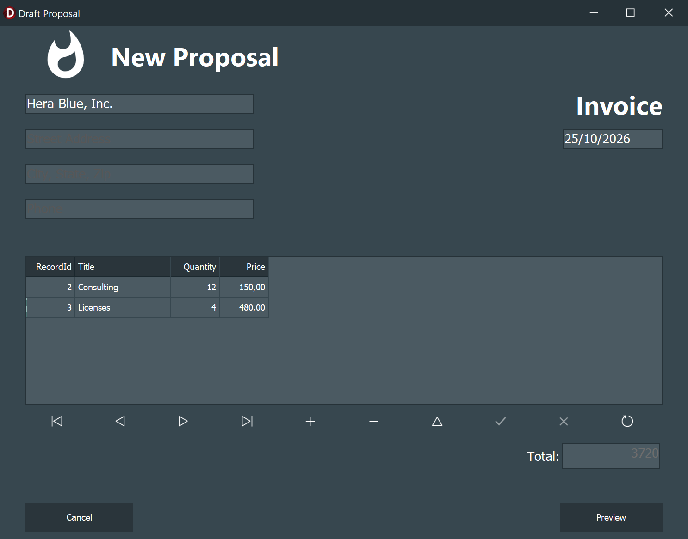

# Asking the assistant

The application carries this manual inside it, and an assistant that has read it. Instead of
looking a page up, you can ask — and for a few things, you can ask it to do the work.



## Two ways to open it

**Press F1.** The assistant opens already asking about the screen you are on: on the Leads
board it asks about Leads, on Marketing about Marketing, and so on. It works from anywhere —
inside a list, on a button, in the side menu.

**Click the round button** in the bottom right corner. That opens the assistant with no
question: use it when what you want to know has nothing to do with where you are.

## Asking a question



Type in the box at the bottom — *"how do I export the mailing list"*, *"what happens if I
remove a user"* — and press Enter. The answer comes from the pages of this manual: the
assistant is told to stay inside them, to cite the page it used, and to say when it does not
know rather than invent. **Read more** opens the whole page inside the assistant.

The conversation stays as you move around the application, and the ↻ button at the top
clears it.

## Keeping an answer

An answer is not only to be read. Move the mouse over one and two small buttons appear
beside it:

| Button | What it does |
| - | - |
| Copy | Puts the answer in the clipboard **with its formatting**: paste it into Word, into an e-mail or into a note and the bold, the lists and the tables are still there. Paste it into a plain text editor and you get clean text |
| Save as PDF | Asks where to put the file and writes it, with the name of the application at the top of every sheet and your name, the date and the page number at the foot |

The same two buttons at the top of the assistant do it for the **whole conversation**,
questions and answers; the ones in the bar of a documentation page do it for **that page**.

You can also simply ask: *"write me a PDF with a summary of what we said"*. The assistant
writes the document and the save dialog opens with it ready.

## Asking it to do things



Three things the assistant can do in this application, and nothing else:

| Ask for | What happens |
| - | - |
| *"open the Marketing screen"* | It switches to that screen |
| *"create a lead for Mario Rossi of Zeus Red, Inc., phone 02 1234567, email mario.rossi@example.com"* | It creates the lead with status **New** and opens its detail window |
| *"prepare a proposal for Gary Orange: 12 hours of consulting at 150 each and 4 licenses at 480 each"* | It opens the proposal draft with the customer and the line items already in, total included |

### It asks before it writes

Anything that changes data stops and asks first, showing exactly what it is about to do:



Answer **No** and nothing happens; the assistant is told you refused and says so. Only
*open the screen* goes ahead without asking, because it changes nothing.

### It prepares, you decide



Notice what the proposal action does **not** do: it fills the draft and leaves it open. The
total is computed, the window is in front of you, and **Preview** and **Save Proposal** are
still yours to press. The same with a new lead: it is created, its window opens, and
correcting what the assistant understood is a normal edit.

## What it sends, and where

The assistant uses Anthropic's Claude, so the question you type, the name of the screen you
are on, the excerpts of this manual that look relevant and the outcome of any action it runs
leave your machine and reach Anthropic's service. **The content of your database does not**:
the leads, the accounts, the proposals and the attached documents stay where they are, and
the assistant cannot read them. Ask it how many leads you have and it will tell you to look
at the [Dashboard](Dashboard.md).

It needs an API key, and without one the assistant still opens: it answers that the key is
missing, and everything else in the application works as always — the assistant is help, not
a requirement.

## Where the key lives

The first run without a key opens a **License activation** window. That is where a real
application would ask its licensing service for the key and keep what comes back; this demo
has no service, so it asks you for an Anthropic key (`sk-ant-...`).

What you paste is not stored the way you typed it. It is encrypted with a secret of this
application and written to `helpchatai.json` in the folder of the application inside your
user profile — `%APPDATA%\VCL_CRMDemo` or `%APPDATA%\FMX_CRMDemo`:

```json
{ "Claude": { "ApiKey": "enc:WMilAglKvAgz..." } }
```

The window only shows up when no key can be found at all. Before asking, the demo looks at
`%APPDATA%\HelpChatAI\helpchatai.json` (shared by every HelpChatAI application), at a
`helpchatai.json` next to the executable and at the `ANTHROPIC_API_KEY` environment
variable — a key written in clear in any of them keeps working, nothing had to change.

Encrypting it is worth something: the configuration file can be copied, backed up or shown
on a screen without giving the key away. It is not a vault, and the demo says so in the
first lines of `CRM Demo\common\uAppSecret.pas` — the passphrase travels inside the
executable, so whoever owns the machine can get it out. An application that needs more asks
its own server for the secret, or lets the key stay on a HelpChatAI server and never reach
the client at all.

## When it does not know

If no page fits, it says so rather than inventing an answer. Two things usually help: ask with
the words the application uses on screen (*proposal*, *lead*, *account*), and ask one thing at
a time.
