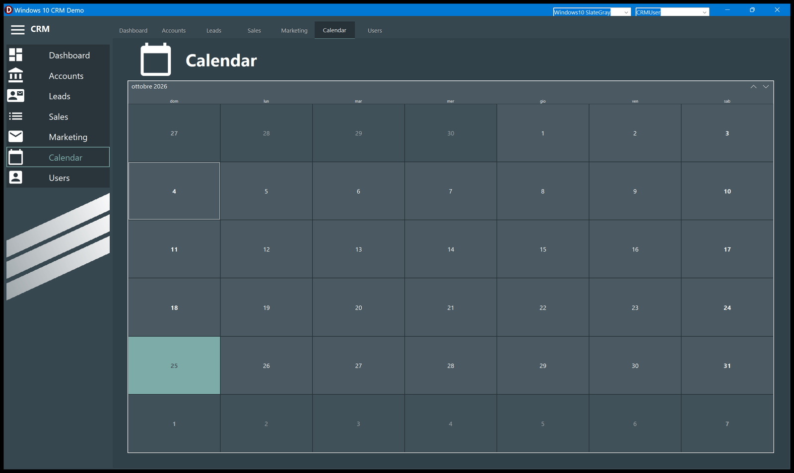

# Calendar

A month at a time, with today highlighted.

Move between months with the two arrows at the top right of the grid, or with the arrow keys
once the calendar has the focus. **Saturdays and Sundays are drawn in bold**, which is the
one piece of behaviour the application adds to the standard control.

The month and day names follow the regional settings of Windows, so on an Italian machine
the heading reads *ottobre 2026* and the columns *dom, lun, mar…*, as in the picture above.

## What it is not

The calendar **shows no data**. Lead dates, proposal dates and completion dates are not
marked on it, selecting a day does not filter anything, and there is no way to add an
appointment. It is a month view and nothing more — see [Known limitations](ToDo.md).

To see the dates of a lead, open it from the [Leads](Leads.md) board: the four dates are at
the top of the [detail window](Lead-Detail.md).
