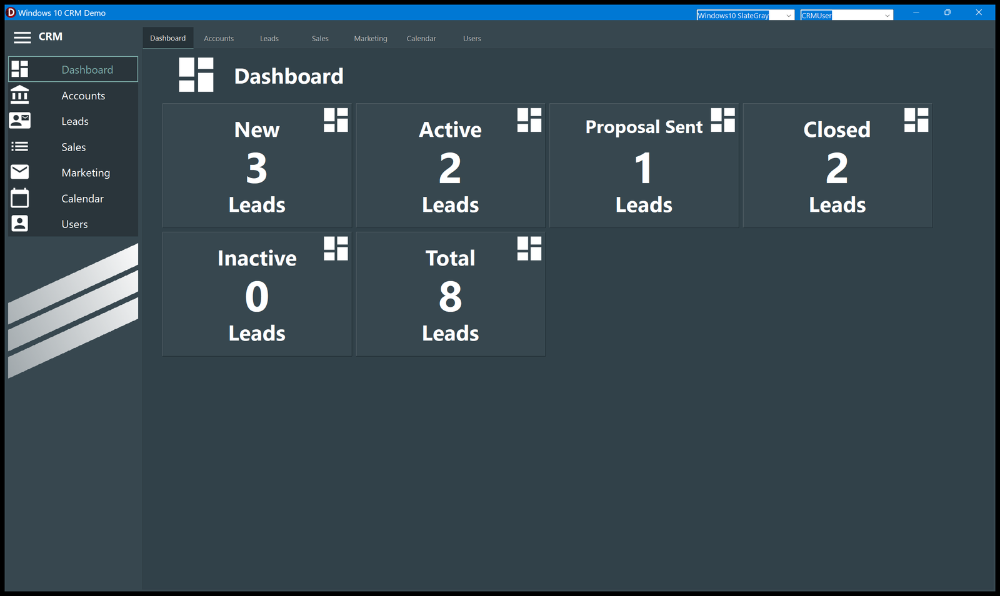

# Dashboard

The opening screen counts the leads of the active user, one tile per status.

| Tile | What it counts |
| - | - |
| **New** | Leads nobody has contacted yet |
| **Active** | Leads being worked on |
| **Proposal Sent** | Leads waiting for an answer to a proposal |
| **Closed** | Leads that ended, won or lost |
| **Inactive** | Leads parked. There is no column for them on the [Leads](Leads.md) board: this tile is the only place they are visible |
| **Total** | Every lead of the user, whatever the status — so it is not the sum of the five tiles above unless every lead has one of those statuses |

Each tile is a separate count over the `Leads` table filtered by the `User` column, so the
numbers follow the user drop-down in the title bar.

## When the numbers change

The counters are **refreshed when you come back to the Dashboard**, not while you work
elsewhere. Move a lead on the Leads board, then click Dashboard: the new numbers are there.
Leave the Dashboard open and change something from another window and the tiles will still
show the old values until you leave and come back.

## Reading the tiles

The tiles are laid out in a flow: they wrap onto a second row when the window is not wide
enough for six. They are decorative — clicking a tile does nothing. To see the leads behind a
number, open [Leads](Leads.md).
