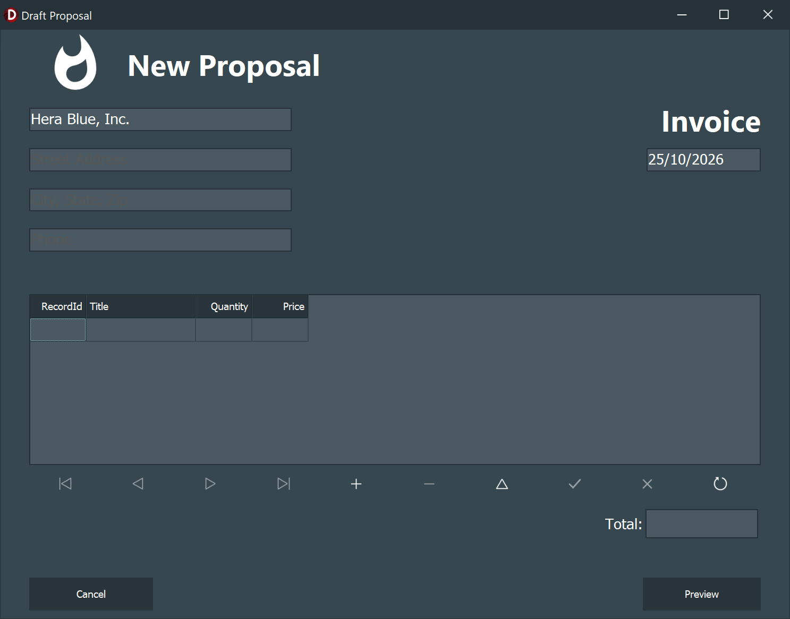
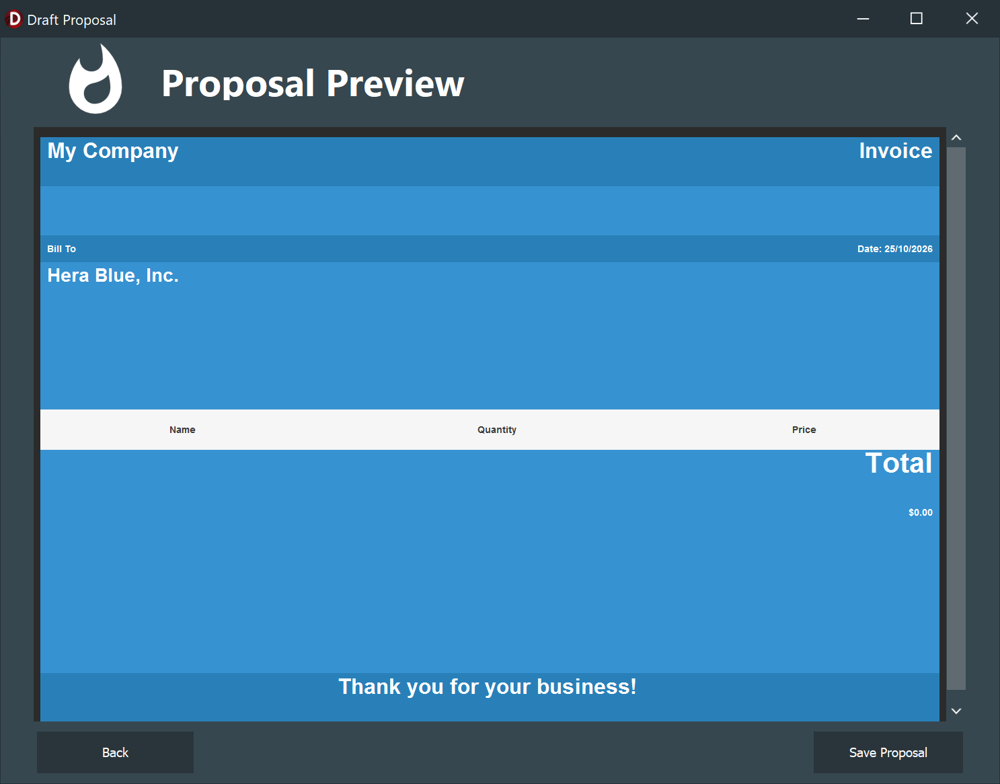

# Draft a proposal

The proposal is an invoice: a header with the customer's address, a list of line items, a
total, and a thank-you line. You fill it in, look at it, and save it.

It opens from **Create Proposal** in the [lead detail](Lead-Detail.md) window, and it is
**modal** — the rest of the application waits until you close it. A lead can have **one**
proposal: ask for a second one and the application says *This lead already has a proposal*.

## Filling in the draft

The company name is already there, taken from the lead's account, and so is today's date.
The three boxes under it — street address, city/state/zip, phone — are yours to type and
start out empty; they are printed as they are, and nothing is validated.

The grid below is the **line items**: a title, a quantity and a price per row. Use the row
of buttons under it to work with them:

| Button | What it does |
| - | - |
| `+` | Adds an empty row |
| `−` | Deletes the current row |
| `✓` | Confirms the row you are editing |
| `✗` | Throws away the row you are editing |
| `↻` | Reloads the list |

**Total** recomputes itself every time a line item changes: it is the sum of quantity × price
over the rows, so you never type it.

The line items live in memory until you save: they belong to this draft only, and
**Cancel** throws the whole thing away.

## The preview

**Preview** turns the draft into the invoice and shows it as it will be stored.

The picture above is a draft with no line items yet, which is why the table is empty and the
total is `$0.00`. With rows in it, each one is printed as name, quantity and price.

The amounts in the document are always written in the English format — `$1,234.50` — whatever
the regional settings of the machine are, because the document is in English.

**Back** returns to the draft to change something; **Save Proposal** stores it.

## Saving

**Save Proposal** writes a row in the proposals table:

- the generated HTML document, kept whole inside the database;
- the **total** as the value of the proposal;
- the status **New**, the creation date, and the active user;
- the link to the lead.

Then the window closes. The proposal now shows up on the [Sales](Sales.md) page and under
**View Proposal** in the lead.

Saving does **not** move the lead to *Proposal Sent* — drag it to that column yourself when
you actually send it.
