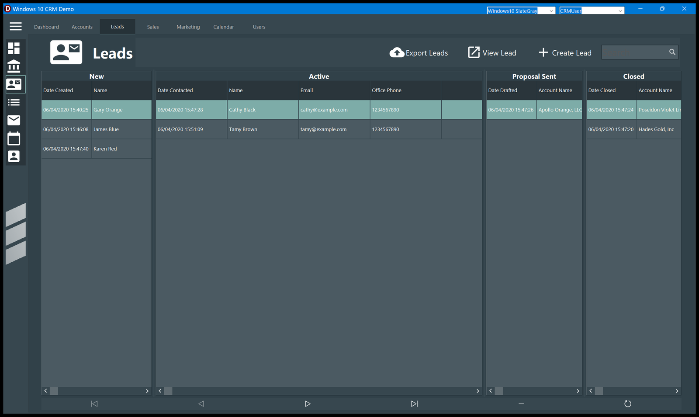

# Getting started

## The first run

There is nothing to install and nothing to configure. The first time you start the
application it:

1. creates `w10crmdemo.sdb` in your **Documents** folder;
2. copies the sample data into it — 8 leads, 8 accounts, one user, three proposals;
3. encrypts the file with AES-256 and reopens it;
4. shows the Dashboard.

Every later run just opens that file. If you want the original sample data back, close the
application, delete `w10crmdemo.sdb` and start it again.

## The sample data

The leads are named after colours (Gary Orange, Cathy Black, James Blue, Karen Red…) and the
accounts after Greek gods (Zeus Red Inc., Hera Blue Inc., Apollo Orange LLC…), so it is easy
to tell at a glance which record you are looking at. They are spread over the four statuses:
three *New*, two *Active*, one *Proposal Sent*, two *Closed*.

The only user is **CRMUser**, and every sample record belongs to it.

## The two drop-downs in the title bar

**The style** on the left changes the look of the whole application immediately. The choices
are the ones compiled into this build: *Windows10 SlateGray* (the default, and the one every
picture in this manual uses), *Windows10 Dark* and *Windows10 Blue*. The window is maximized
when you change it.

> The icons of the application are white, so they only show up well on a dark style. On
> *Windows10 Blue* they are readable too; a light style would wash them out.

**The user** on the right chooses whose records you see — see [Users](Users.md).

## Making the window smaller

The layout reacts to the width:

- under about 640 points the **navigation menu collapses to icons** by itself, and opens
  again when you make the window wider;
- each section's buttons **drop their captions and shrink to icons** when their banner gets
  too narrow, so they never overlap the search box;
- the ☰ button collapses and expands the menu whatever the width is.

The picture above is the Leads board with the menu collapsed: the four columns get the room
the menu was using.

## Keyboard

The application defines no shortcuts of its own. The usual Windows keys work: `Tab` moves
between the controls, the arrow keys move inside the grids, `F10`/`Alt` reaches the window
menu. Typing in a **Search** box filters as you type — there is no button to press and no
`Enter` to confirm.
