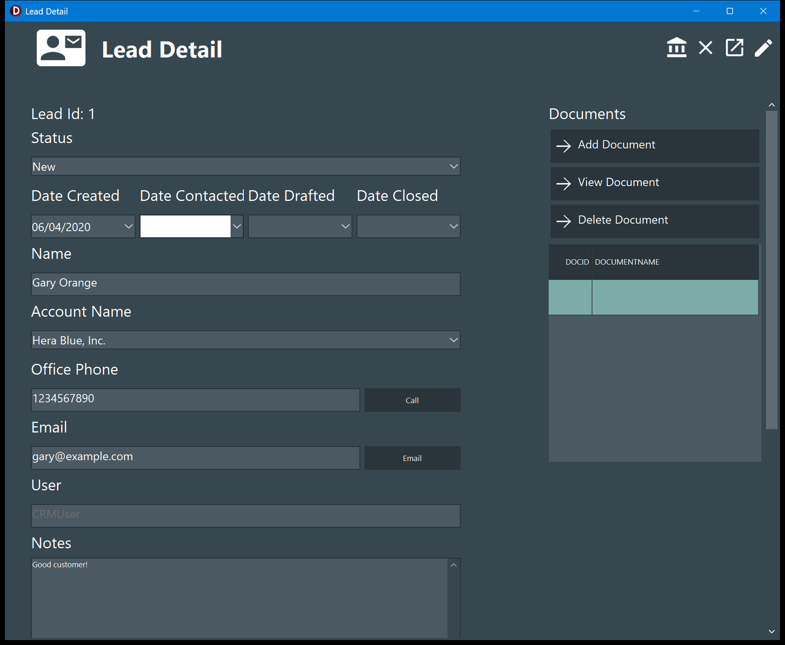

# Lead detail

Everything about one lead: who it is, where it stands, the documents attached to it and the
proposal sent to it.

It opens from the [Leads](Leads.md) board, by double-clicking a row or pressing **View Lead**.
The window is not modal: you can leave it open and keep moving around the board, and it
follows the selection.

## The fields

| Field | Notes |
| - | - |
| **Lead Id** | Assigned by the database, shown for reference only |
| **Status** | The five statuses, picked from a list. Changing it here moves the lead to another column of the board, exactly like dragging it — except that **no date is stamped** |
| **Date Created / Contacted / Drafted / Closed** | The four stages. An empty date shows an empty box; pick one from the calendar to fill it, and it stays until you change it |
| **Name** | The person |
| **Account Name** | Picked from the [accounts](Accounts.md). The proposal prints this name as "Bill To" |
| **Office Phone**, **Email** | Free text, not validated |
| **User** | Who the lead belongs to. It follows the active user and is not meant to be edited here |
| **Notes** | Free text, up to 2048 characters |

Every field is written to the database as soon as you leave it — there is no Save button and
no Cancel. Closing the window keeps what you typed.

> The **Call** and **Email** buttons beside the phone and the e-mail do nothing: they are
> placeholders. See [Known limitations](ToDo.md).

## Documents

The panel on the right holds the files attached to this lead. They are stored **inside the
database**, not referenced on disk, so the attachment travels with the `.sdb` file.

- **Add Document** asks for a file and loads it whole into the database, keeping the file
  name and recording who attached it.
- **View Document** writes the selected document to your temporary folder and opens it with
  whatever program Windows associates with that extension. If no document is selected it
  says so.
- **Delete Document** asks for confirmation, naming the document, and then removes it.

The list shows the id and the document name; it is filtered by lead and by the active user.

## The four buttons in the banner

At the top right, left to right:

| Button | What it does |
| - | - |
| **Complete Proposal** | Marks this lead's proposal as *Accepted* and stamps its completion date |
| **Cancel Proposal** | Marks it as *Canceled*. The proposal stays in the database |
| **View Proposal** | Opens the saved proposal — see [Sales](Sales.md) |
| **Create Proposal** | Opens the [draft](Draft-Proposal.md) window. **One proposal per lead**: if there already is one, it tells you so and does nothing |

When the window is narrow the four buttons lose their captions and stay as icons, in that
same order.

Note that Complete and Cancel act on the **proposal**, not on the lead: neither of them moves
the lead to *Closed*. Moving it is up to you, on the board.
