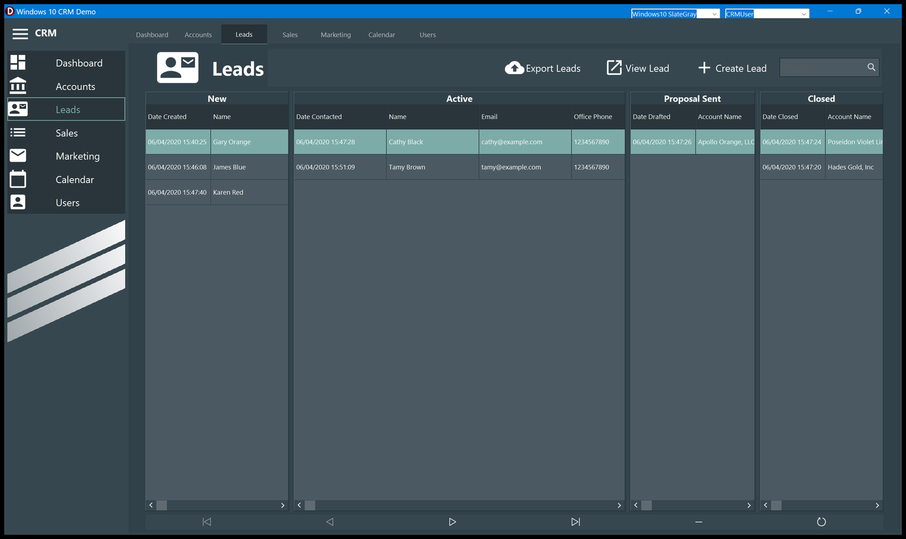

# Leads

The board where the work happens: four columns, one per status, and a lead moves from left to
right as it progresses.

| Column | Meaning | Columns shown |
| - | - | - |
| **New** | Nobody has called yet | Date Created, Name |
| **Active** | Being worked on | Date Contacted, Name, Email, Office Phone, Lead Id |
| **Proposal Sent** | A proposal is out, waiting for an answer | Date Drafted, Account Name |
| **Closed** | Finished | Date Closed, Account Name |

Each column shows the date that matters at that stage, which is why the first column is
different in each one.

A fifth status, **Inactive**, exists in the data but has no column here: those leads are only
counted on the [Dashboard](Dashboard.md).

## Moving a lead: drag and drop

Drag a row from one column and drop it on another. Two things happen:

1. the lead takes the **status of the column you dropped it on**;
2. if the date of that stage is still empty, it is **stamped with now** — `Date Contacted`
   moving to Active, `Date Drafted` moving to Proposal Sent, `Date Closed` moving to Closed.
   A date that already has a value is left alone, so moving a lead back and forth does not
   rewrite its history.

Dropping a lead on the column it already is in does nothing.

The four lists refresh after every move, and the lead you dragged stays selected.

## Opening a lead

**Double-click** a row, or select it and press **View Lead**. Either one opens the
[lead detail](Lead-Detail.md) window on that lead.

Simply moving the selection in a column is enough to make that lead the current one — the
detail window, if it is open, follows the selection, and the navigator at the bottom of the
page starts acting on the column you clicked last.

## Create Lead

**Create Lead** makes a new lead straight away, with no questions asked:

- status **New**, so it appears at the bottom of the first column;
- name **First Last**, a placeholder you are meant to replace;
- the active user, and `Date Created` set to now.

The detail window opens on it immediately so you can fill it in.

## Search

The **Search** box filters **all four columns at once**, as you type. It matches, ignoring
case and anywhere inside the value, against the lead's **name, account name, office phone or
e-mail** — so typing `black` finds Cathy Black, and typing `example.com` finds everybody.

Clear the box to get the full board back.

## Export Leads

**Export Leads** writes the whole `Leads` table to a file you choose, in FireDAC's own format
(the extension decides between binary, XML and JSON). It is a backup you can read back with
the same application, not a spreadsheet.

## The navigator at the bottom

The arrows move through the column you last clicked in; `−` deletes the current lead and `↻`
reloads the list. There is no confirmation on the delete.
