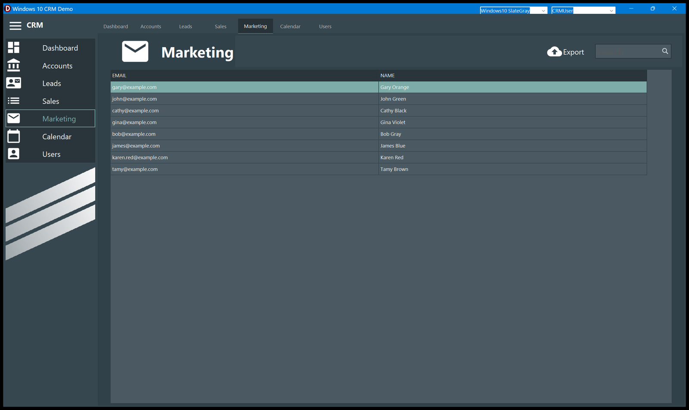

# Marketing

The mailing list: the e-mail address and the name of every lead of the active user that is
not *Inactive*.

The list is built from the leads, not stored separately, so it is always up to date: change
a lead's e-mail and it changes here; park a lead as *Inactive* and it drops out. Leads
without an address appear with an empty e-mail — nothing filters them out.

The list is read-only: there is no navigator under it and nothing to edit. Fix an address in
the [lead detail](Lead-Detail.md) window.

## Search

The **Search** box filters as you type, on the **e-mail address** (not the name), ignoring
case and matching anywhere — `example.com` keeps everybody, `karen` finds one.

## Export

**Export** writes the list to a **delimited text file** with a header row of field names: the
one export in the application that a spreadsheet or a mailing tool can read directly. It
writes what the query returns — so the current search filter **does** apply, unlike the
exports on the [Accounts](Accounts.md) and [Leads](Leads.md) pages, which always write the
whole table.

Choose the file name in the dialog; the application overwrites it without asking.

> The application writes a `Data.log` next to the exported file, a log of the copy. It is
> harmless and can be deleted.
