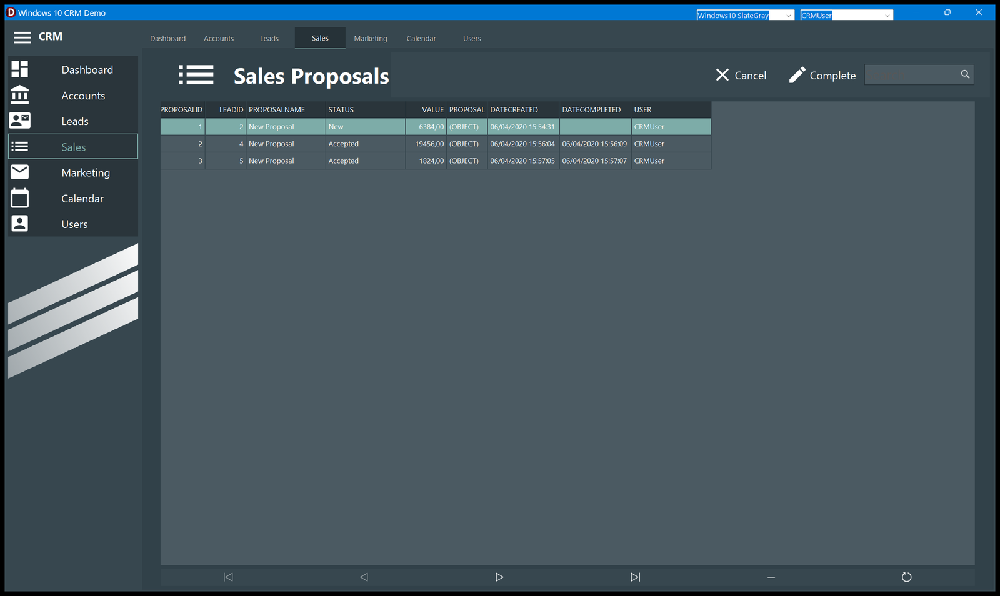
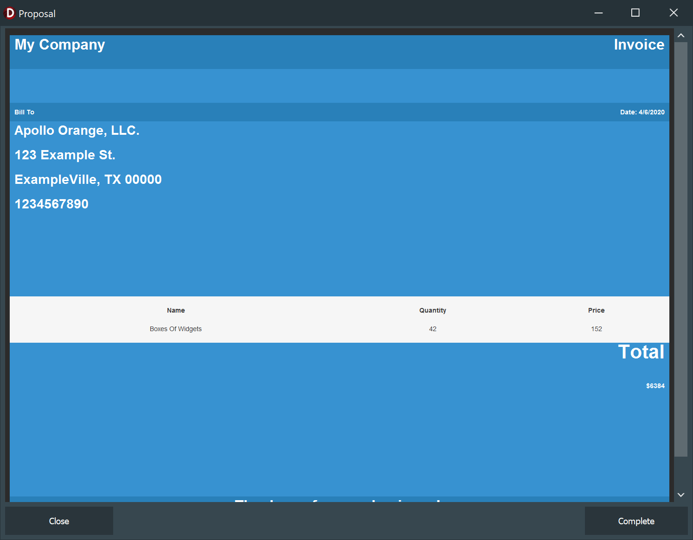

# Sales

Every proposal of the active user, in one list.

| Column | Meaning |
| - | - |
| **ProposalId** | Assigned by the database |
| **LeadId** | The lead the proposal was written for |
| **ProposalName** | Always `New Proposal`: the draft window does not ask for a name |
| **Status** | `New` when saved, then `Accepted` or `Canceled` |
| **Value** | The total of the invoice, as it was when you saved it |
| **Proposal** | The document itself. The grid cannot show it and prints `(OBJECT)` |
| **DateCreated**, **DateCompleted** | When it was saved, and when it was accepted |
| **User** | Who wrote it |

## Complete and Cancel

The two buttons in the banner act on the **selected** proposal:

- **Complete** sets the status to `Accepted` and stamps `DateCompleted` with now;
- **Cancel** sets the status to `Canceled` and leaves the completion date alone.

Neither asks for confirmation, and both can be applied again later — nothing is locked once
a proposal is accepted. If the list is empty the buttons do nothing.

The same two actions are on the [lead detail](Lead-Detail.md) window, where they apply to
that lead's proposal.

## Search

The **Search** box filters as you type, on the **proposal name** only — which, since every
proposal is called `New Proposal`, is not as useful as it sounds. To find the proposal of a
given customer, open the lead and press **View Proposal**.

## Reading a proposal

**View Proposal** in the lead detail opens the document stored in the database, exactly as it
was saved. The window has two buttons: **Close**, and **Complete**, which does the same thing
as Complete here — marks the proposal accepted and closes the window.
