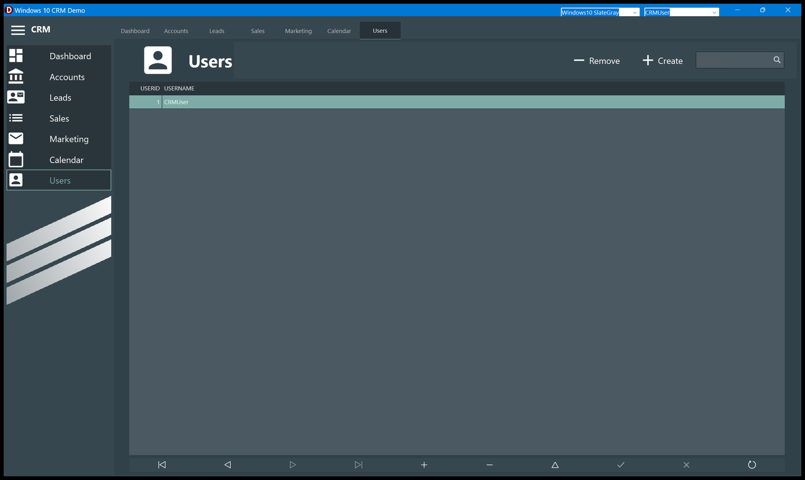

# Users

The names records can belong to. The sample database has one, **CRMUser**, and everything in
it belongs to that user.

## What a user is here

Not an account you log into — there is no password and no permission. A user is a **label**
on a record and a **filter** on what you see. The drop-down at the right of the title bar
picks the active one, and from that moment:

- the [Leads](Leads.md) board, the [Sales](Sales.md) list, the documents of a lead and the
  [Marketing](Marketing.md) list show only the records whose `User` matches;
- the [Dashboard](Dashboard.md) counters count only those;
- anything you create — a lead, a proposal, a document — is stamped with that name.

Accounts are the exception: they are shared by everybody.

Switching user closes the lead, draft and proposal windows that are open, so you never keep
looking at a record that the new filter has hidden.

## Create

**Create** asks for the name, starting from `user`. It is the one place in the application
that checks for duplicates: a name already in the list is refused with *A user with that
username already exists*.

The new user starts with nothing — an empty board, zeros on the dashboard. To give it
something to work on, switch to it and create a lead, or change the `User` of an existing
one.

## Remove

**Remove** deletes the selected user immediately, **without asking**.

Nothing checks whether that user owns anything. The leads, proposals and documents stamped
with that name stay in the database but **stop being visible**, because no user in the
drop-down matches them any more. Removing the only user leaves an application that shows
nothing at all.

If it happens, the way back is to create a user with exactly the same name as before: the
records are keyed by the name, so they reappear.
