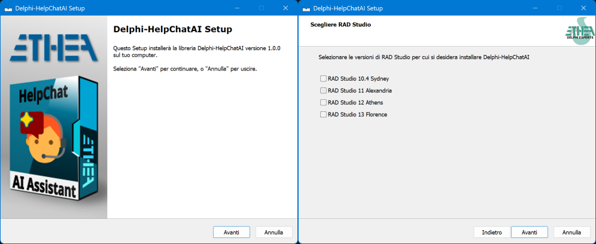

# HelpChatAI for Delphi

[](LICENSE)
[](https://github.com/EtheaDev/Delphi-HelpChatAI/releases)
[](https://www.embarcadero.com/products/delphi)
[](https://docwiki.embarcadero.com/RADStudio/en/Main_Page)
[](https://developer.microsoft.com/microsoft-edge/webview2/)
[](https://www.microsoft.com/windows)


Related links: https://www.embarcadero.com/ - https://learndelphi.org/

---

## An in-app AI help assistant for your VCL and FireMonkey applications

Your users do not read the manual: they ask. HelpChatAI puts a chat bubble in the corner of
your application, answers *"how do I export this grid?"* from **your own documentation**, and
knows which screen the user is on while answering. **F1 opens it**, through the standard Delphi
help system, so the `HelpKeyword` you already wrote keeps working.

| Component | Description |
| - | - |
|  | **TVclHelpChatAI** is the VCL component: drop it on the main form, set `Active`, and you have the bubble, F1 contextual help and the chat panel (a WebView2 `TEdgeBrowser`), either in its own tool window or embedded in a container of yours. Colours follow the active VCL style |
|  | **TFmxHelpChatAI** is the FireMonkey twin (Delphi 12+): same settings, same engine, the chat in a `TWebBrowser`. F1 through the host form's `OnKeyDown`, light/dark theme instead of VCL styles. Available only for Delphi 12 and 13 |

### How it works

1. You build a **documentation index** (`help-index.json`) from the Markdown pages of your
   manual, with the `HelpIndexBuilder` tool.
2. The user asks. The component adds the **screen context** — the active form, its caption, the
   `HelpKeyword`/`HelpContext` of the focused control, the active tab.
3. A **provider** answers. `docsearch` finds the right page offline and quotes it, with no API
   key at all; `claude`, `openai` and `gemini` read the pages the retriever found and answer
   *from those*, citing the source and saying when they do not know.
4. The reply **streams** into the panel token by token, rendered as safe HTML. Nothing ever
   runs on the UI thread, and the user can stop it.
5. If you let it, the assistant can also **act**: you register the actions your application
   allows, and it calls them on the main thread, asking the user first when they change data.

The engine knows nothing about the UI: it runs inside your application or on a **HelpChatAI
server**, chosen in a configuration file, so the model API key never has to reach the user's
machine.

### Providers

| `Provider` | Needs | Streams | Actions |
|---|---|---|---|
| `docsearch` | the documentation index, no key | no | no |
| `claude` | `ANTHROPIC_API_KEY` | yes | yes |
| `openai` | `OPENAI_API_KEY`, nothing for a local model | yes | yes |
| `gemini` | `GEMINI_API_KEY` | yes | yes |

`openai` is wider than its name: Chat Completions is the API that Azure OpenAI, Groq,
OpenRouter, Mistral, DeepSeek, Ollama and LM Studio also speak, so `BaseUrl` and `Model` are
enough to point the same provider at any of them — including a model running on the user's own
machine, where nothing leaves the PC.

## Setup for automatic installation of components

An "Installer" ready to use is located in the Release area:
[Download the Installer](https://github.com/EtheaDev/Delphi-HelpChatAI/releases/latest/download/HelpChatAI_Setup.exe).

The Installer automatically detects your Delphi versions, installs sources, builds and installs
packages and adds source paths.



To do it by hand instead:
- open the group project of your version under `packages/` — `Delphi13`,
`Delphi12`, `Delphi11` or `Delphi10.4` 
- build it and install `dclHelpChatAIVcl` (and
`dclHelpChatAIFmx`, then add `source` and `Ext/MarkdownProcessor/source` to the library path.

`Tools/Build_Packages.cmd [Delphi13|Delphi12|Delphi11|Delphi10.4|all]` builds them from a
command line.

Ship `WebView2Loader.dll` (`Redist/WebView2/x86|x64`) next to your executable; the WebView2
runtime itself is already part of Windows 11 and of every machine with Edge.

## Documentation

Follow the [Project Site](https://ethea.it/docs/helpchatai/) to learn how to add an AI help
assistant to your Delphi application, and how to make its answers good.

| Page | What you find |
|---|---|
| [Quick Start](https://ethea.it/docs/helpchatai/Quick-Start) | From an empty form to a working chat |
| [The VCL component](https://ethea.it/docs/helpchatai/VCL-Component) | Bubble, F1, embedding, dictation, the design-time preview |
| [The FMX component](https://ethea.it/docs/helpchatai/FMX-Component) | What FireMonkey does differently |
| [Providers](https://ethea.it/docs/helpchatai/Providers) | The five of them, their settings, writing your own |
| [The documentation index](https://ethea.it/docs/helpchatai/Documentation-Index) | Building `help-index.json`, and the pages shown inside the panel |
| [Actions](https://ethea.it/docs/helpchatai/Actions) | An assistant that does things, safely |
| [Running the engine on a server](https://ethea.it/docs/helpchatai/Server) | When the API key must not be on the user's machine |
| [Configuration](https://ethea.it/docs/helpchatai/Configuration) | `helpchatai.json`, and checking a configuration |
| [Security and privacy](https://ethea.it/docs/helpchatai/Security-and-Privacy) | What travels, where, and what never does |

## Supported Delphi versions

| Framework | Versions | Verified |
|---|---|---|
| Engine (RTL only) | Delphi 10.4 Sydney → 13 Florence | packages built with each compiler |
| VCL (`TEdgeBrowser`) | Delphi 10.4 → 13 | built on all four, run on 13 |
| FMX (`TWebBrowser`) | Delphi 12 → 13 | built on both, run on Windows |

FireMonkey compiles for macOS, iOS and Android, but only Windows has been tried so far.

## Packages

One folder per Delphi version, the same `.dpk` for all of them.

| Package | Requires | Contents |
|---|---|---|
| `HelpChatAI` (runtime) | rtl, MarkdownProcessor | the engine, the index builder, the panel page |
| `HelpChatAIServer` (runtime) | HelpChatAI, Indy | the transports: local server, remote server, remote client, host channel |
| `HelpChatAIVcl` (runtime) | HelpChatAIServer, vcl, vcledge | `TVclHelpChatAI`, the chat control, VCL style theming |
| `dclHelpChatAIVcl` (design-time) | HelpChatAIVcl, designide | palette, splash and About box, component editor with the live preview, property editors |
| `HelpChatAIFmx` (runtime) | HelpChatAIServer, fmx | `TFmxHelpChatAI` and its chat control |
| `dclHelpChatAIFmx` (design-time) | HelpChatAIFmx, designide | palette, component editor with the configuration check |

## Demo and tests

`CRM Demo` is the Windows 10 CRM demo of Embarcadero with HelpChatAI in it: a real little
application — leads, accounts, proposals — with a manual of sixteen pages in `CRM Demo\Help`
and the assistant answering from it. Press **F1** on any screen, or ask it to open a screen,
create a lead or prepare a proposal.

It comes **in both frameworks**, sharing one data module, one database and one manual:

| | Project | Delphi | What it is |
|---|---|---|---|
| VCL | `CRM Demo\VCL\project\VCL_CRMDemo.dproj` | 10.4 → 13 | The whole application: seven pages, the lead and proposal windows, and all three actions |
| FMX | `CRM Demo\FMX\project\FMX_CRMDemo.dproj` | 12 → 13 | The main form alone — the same seven pages over the same data — so the FireMonkey half of the library runs in a real application. One action, `open_screen`, because the windows the other two open are not ported |

`CRM Demo\BuildAllDemos.ps1` builds both with every Delphi it finds, Win32 and Win64: twelve
builds, and the FireMonkey ones are reported `N/A` below Delphi 12 rather than failed.

`Test/Delphi13/HelpChatAITests.dproj` is a DUnitX suite of **246 tests** that runs without
network: store, worker pool, cancellation, index scoring, Markdown safety, the SSE parsing and
request building of each model provider, the configuration check, both transports over real
HTTP, and the actions from a real worker thread.

```
Test\Bin\Win32\HelpChatAITests.exe --exitbehavior:Continue
```

## Release Notes ##

27 Oct 2026: ver. 1.1.0
- `Caption` and `AssistantName` on both components: the title of the window the chat opens in, and the name written in the header of the panel. Empty - the default - means the word of the current language, so an English application reads "Help" and "Assistant" and an Italian one "Aiuto" and "Assistente" without anybody writing them
- The header of the panel shows the icon of the bubble next to the name. Name and icon reach the page the way the colours do, through the transport and `POST /api/assistant`: an image list is an object of the framework, so only the client can know it
- The icons of the assistant moved to the engine (`HelpChatAI.Assistant`), where both frameworks can reach them. For the built-in ones the icon the page loads is the PNG itself, with its transparency, and no drawing in between
- FireMonkey caught up with the VCL: the bubble is round and wears the icon, and `Images`, `ImageIndex` and `ImageName` are published there too, with the four names in the Object Inspector
- Fixed, both found by running the new FireMonkey demo: the FMX bubble was placed outside the window the first time the form was resized (FireMonkey computes the anchor rules once, against the parent the control has at that moment, and it had none yet), and a relative `DocIndexFile` was resolved against the current directory instead of the executable, so the documentation index was found or not depending on who started the application
- **Two sample applications**, `CRM Demo\VCL` and `CRM Demo\FMX`, sharing one data module and one manual. The FireMonkey one is the main form alone - the seven pages, the same bind sources, `TFmxHelpChatAI` with a `HelpKeyword` per tab - and needs Delphi 12 or later, because `TFmxHelpChatAI` starts there
- 246 tests, and a build matrix of 12: VCL on Delphi 10.4 to 13, FMX on 12 and 13, Win32 and Win64

25 Oct 2026: ver. 1.0.0
- First release: in-app AI help chat for VCL (Delphi 10.4+) and FMX (Delphi 12+) applications
- Engine (RTL only) with the providers `docsearch` (local documentation index, no key needed), `claude` (Anthropic), `openai` (Chat Completions, and with it Azure, Groq, OpenRouter, Mistral, Ollama...) and `gemini` (Google): all three models stream and can call the actions of the application, grounded on the documentation and on the screen context
- `TVclHelpChatAI` (`TEdgeBrowser`) and `TFmxHelpChatAI` (`TWebBrowser`): chat bubble, F1 contextual help, chat panel embeddable in any container, colours from the VCL style
- An assistant that acts: the application registers the actions it may call, with confirmation for the ones that change data
- Question dictation, design-time live preview and configuration check
- HelpChatAI server: engine, index and API key on a server, remote transport chosen in the configuration file
- HelpIndexBuilder: builds the documentation index (`help-index.json`) from a folder of Markdown files
- Packages for Delphi 10.4, 11, 12 and 13, DUnitX tests and installer
- A sample application with the component in it: the Windows 10 CRM demo of Embarcadero, with a manual of its own, F1 on every screen and three actions the assistant can run

## License

Apache License 2.0 — Copyright (c) 2026 Ethea S.r.l.

The Ethea MarkdownProcessor, which the engine package requires, keeps its own license
(Apache 2.0 / BSD, see [Delphi-MarkdownProcessor](https://github.com/EtheaDev/MarkdownProcessor)).
