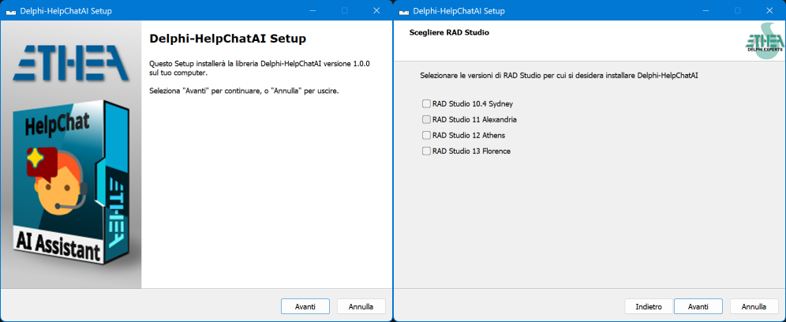

# HelpChatAI for Delphi

[](LICENSE)
[](https://github.com/EtheaDev/Delphi-HelpChatAI/releases)
[](https://www.embarcadero.com/products/delphi)
[](https://docwiki.embarcadero.com/RADStudio/en/Main_Page)
[](https://developer.microsoft.com/microsoft-edge/webview2/)
[](https://www.microsoft.com/windows)


Related links: https://www.embarcadero.com/ - https://learndelphi.org/

---

## An in-app AI help assistant for your VCL and FireMonkey applications

Your users do not read the manual: they ask. HelpChatAI puts a chat bubble in the corner of
your application, answers *"how do I export this grid?"* from **your own documentation**, and
knows which screen the user is on while answering. **F1 opens it**, through the standard Delphi
help system, so the `HelpKeyword` you already wrote keeps working.

| Component | Description |
| - | - |
|  | **TVclHelpChatAI** is the VCL component: drop it on the main form - or on any form that deserves an expert of its own - set `Active`, and you have the bubble, F1 contextual help and the chat panel (a WebView2 `TEdgeBrowser`), either in its own tool window or embedded in a container of yours. Colours follow the active VCL style |
|  | **TFmxHelpChatAI** is the FireMonkey twin (Delphi 12+): same settings, same engine, the chat in a `TWebBrowser`. F1 through the host form's `OnKeyDown`, light/dark theme instead of VCL styles. Available only for Delphi 12 and 13 |

### How it works

1. You build a **documentation index** (`help-index.json`) from the Markdown pages of your
   manual, with the `HelpIndexBuilder` tool.
2. The user asks. The component adds the **screen context** — the active form, its caption, the
   `HelpKeyword`/`HelpContext` of the focused control, the active tab.
3. A **provider** answers. `docsearch` finds the right page offline and quotes it, with no API
   key at all; `claude`, `openai` and `gemini` read the pages the retriever found and answer
   *from those*, citing the source and saying when they do not know.
4. The reply **streams** into the panel token by token, rendered as safe HTML. Nothing ever
   runs on the UI thread, and the user can stop it.
5. If you let it, the assistant can also **act**: you register the actions your application
   allows, and it calls them on the main thread, asking the user first when they change data.
6. And it can **read a document the user hands it**: a paper clip next to the question box
   takes a PDF, an image or a text file. Together with an action, that is a PDF filling a
   form without anybody retyping it. Off until you turn it on, because an attachment leaves
   the machine.
7. What it answered does not stay in the panel. Every answer, the whole conversation and
   every page of the manual can be **copied** — as text and as HTML, so a table pasted into
   Word is still a table — or **saved as a PDF**, laid out by a stylesheet of yours and
   headed with the name of your application, the user and the page number.

The engine knows nothing about the UI: it runs inside your application or on a **HelpChatAI
server**, chosen in a configuration file, so the model API key never has to reach the user's
machine. When it has to, every key has two nodes in the configuration: `ApiKey` in clear, which
you develop with and the IDE reads, and `ApiKeyEncrypted`, which your application writes with
its own cipher and decrypts in `OnDecryptSecret` at run time. A file you deploy carries only
the encrypted one.

### Providers

| `Provider` | Needs | Streams | Actions |
|---|---|---|---|
| `docsearch` | the documentation index, no key | no | no |
| `claude` | `ANTHROPIC_API_KEY` | yes | yes |
| `openai` | `OPENAI_API_KEY`, nothing for a local model | yes | yes |
| `gemini` | `GEMINI_API_KEY` | yes | yes |

`openai` is wider than its name: Chat Completions is the API that Azure OpenAI, Groq,
OpenRouter, Mistral, DeepSeek, Ollama and LM Studio also speak, so `BaseUrl` and `Model` are
enough to point the same provider at any of them — including a model running on the user's own
machine, where nothing leaves the PC.

### More than one model

`Models` in `helpchatai.json` lists the models the user may switch between from the panel: each
one has a name, a provider, and the model, endpoint and key it adds to that provider's section
when they differ — three local models on one Ollama are three entries on `openai`.
`SelectedModel` names the one in use at start; the choice made in the panel is remembered per
user. The header shows the icon of the model in use (deduced from the model name, then from the
endpoint, then from the provider; `Icon` overrides it), with name and model as the tooltip, and
with more than one model a click on it opens the list. With no list, `Provider` alone is the
one model and nothing can be switched.

```json
{
  "SelectedModel": "Claude",
  "Models": [
    { "Name": "Claude", "Provider": "claude", "Model": "claude-haiku-5-5" },
    { "Name": "Gemini", "Provider": "gemini", "Model": "gemini-3.5-flash-lite" },
    { "Name": "Gemma (local)", "Provider": "openai", "Model": "gemma4:12b", "BaseUrl": "http://localhost:11434/v1" }
  ]
}
```

The icons of the providers and models are those of [lobe-icons](https://github.com/lobehub/lobe-icons)
(MIT); the logos themselves are trademarks of their respective owners.

### More than one assistant: profiles

A large application can have **several assistants, each the expert of one part of it**, and
active at the same time: a general one on the main form, and one on the form of an important
function - order entry, planning - with its own name, its own instructions, its own part of the
manual, its own models and the actions only it may run.

- **One component per form, one `Profile` per assistant.** The component lives on the form that
  owns it: its bubble is there, and **F1 goes to the assistant of the active form** - on a form
  with none (a dialog, a print preview), to the one whose form was active last.
  `CurrentAssistant` says which one that is. One help viewer and one message hook serve them all.
- **One configuration file, a root and a section per assistant.** The root holds what every
  assistant shares (keys, endpoints, the catalogue of models); `"Profiles"` holds, under the
  `Profile` of each component, what that assistant changes, with the same keys. Within a file
  the profile wins over the root.
- **An expert knows an area of the manual.** One manual, one index: the area of a page is its
  sub-folder (or the `areas:` of its front matter), and `DocAreas` says which areas an
  assistant answers from. The pages of no area belong to everybody.
- **Actions belong to the form that registers them**, plus those the whole application shares
  (`HelpChatSharedActions`); `AllowedActions` in a profile narrows them, and can never add one
  the code did not register.
- **Two windows of the same profile are one assistant**: one engine, one conversation, the
  index loaded once, while an action still fills the window it was asked from. Each profile
  keeps its own conversation, choices and window position.

```json
{
  "Claude": { "ApiKey": "sk-ant-..." },
  "Models": [
    { "Name": "Claude", "Provider": "claude", "Model": "claude-haiku-5-5" },
    { "Name": "Gemma (local)", "Provider": "openai", "Model": "gemma4:12b",
      "BaseUrl": "http://localhost:11434/v1" }
  ],
  "Profiles": {
    "Orders": {
      "AssistantName": "Giulio",
      "Instructions": "You are the expert of order entry.",
      "DocAreas": ["Orders", "Customers"],
      "Models": ["Claude"],
      "AllowedActions": ["create_order", "open_screen"]
    }
  }
}
```

All of this is edited from the IDE too: **Configuration...**, the first verb of both component
editors (and what a double click opens), shows every setting with the value in force and where
it comes from - the library, the component, a file and its root or profile - and writes it to
the profile, to the root of a file or to the component. It edits keys in their clear node only,
and never puts one in the form file. The VCL and FireMonkey editors are two native views over
one controller.

### Commands

A line that starts with `/` in the question box is a command, answered without the model:
`/who` (assistant, model, provider, endpoint), `/use name` and `/retry [name]` (switch, ask
again), `/search words` (the pages the answer would be grounded on), `/pages` and `/doc page`,
`/context` (the screen F1 knows), `/actions` (what the assistant can do here), `/check` (the
configuration check), `/stats`, `/clear`, `/pdf`, `/copy`, `/attach`, `/help`. `EnabledCommands`
on the component is the set the panel accepts: all of them by default except `/prompt`, which
shows the instructions and excerpts the last question went with, and `/run action name=value`,
which runs a registered action by hand (with the usual confirmation). Every answer starts with
what it answers, e.g. "Available actions (/actions):".

Everything the panel does can be done from code on the component: `ExecuteCommand(hccActions)`
shows an answer in the panel (any command, enabled or not), `ExplainCommand(hccActions)` returns
it as text without opening anything, and `ClearConversation`, `SelectModel`, `Models`,
`RetryLastQuestion`, `SaveConversationPdf`, `CopyLastAnswer` and `AttachFile` do what their buttons do.

## Setup for automatic installation of components

An "Installer" ready to use is located in the Release area:
[Download the Installer](https://github.com/EtheaDev/Delphi-HelpChatAI/releases/latest/download/HelpChatAI_Setup.exe).

The Installer automatically detects your Delphi versions, installs sources, builds and installs
packages and adds source paths.



To do it by hand instead:
- open the group project of your version under `packages/` — `Delphi13`,
`Delphi12`, `Delphi11` or `Delphi10.4` 
- build it and install `dclHelpChatAIVcl` (and
`dclHelpChatAIFmx`, then add `source` and `Ext/MarkdownProcessor/source` to the library path.

`packages/BuildAllPackages.ps1` builds them from a command line, every installed version or
the ones named with `-DelphiVersion D13,D12`; `BuildAllPackagesD13.ps1` (and D12, D11, D10.4)
does one version.

Ship `WebView2Loader.dll` (`Redist/WebView2/x86|x64`) next to your executable; the WebView2
runtime itself is already part of Windows 11 and of every machine with Edge.

## Installation with DPM (Delphi Package Manager)

The library is also published on [delphi.dev](https://delphi.dev/packages/etheadev.helpchatai) as the package **EtheaDev.HelpChatAI** (Delphi 10.4 to 13, Win32 and Win64): you can install it with [DPM, the Delphi Package Manager](https://delphi.dev), as an alternative to the Setup. From the IDE, right click on your project in the Project Manager and choose *Manage DPM Packages*, or from the command line:

```
dpm install EtheaDev.HelpChatAI <path of your project>.dproj
```

DPM downloads the package, builds it for the Delphi version and the platforms of your project and adds it to the project. Its dependencies are installed automatically: EtheaDev.MarkdownProcessor from delphi.dev and Indy from your Delphi installation.

## Documentation

Follow the [Project Site](https://ethea.it/docs/helpchatai/) to learn how to add an AI help
assistant to your Delphi application, and how to make its answers good.

| Page | What you find |
|---|---|
| [Quick Start](https://ethea.it/docs/helpchatai/Quick-Start) | From an empty form to a working chat |
| [The VCL component](https://ethea.it/docs/helpchatai/VCL-Component) | Bubble, F1, embedding, dictation, the design-time preview |
| [The FMX component](https://ethea.it/docs/helpchatai/FMX-Component) | What FireMonkey does differently |
| [Providers](https://ethea.it/docs/helpchatai/Providers) | The five of them, their settings, writing your own |
| [Assistants and models](https://ethea.it/docs/helpchatai/Assistants) | Several assistants in one application, their profiles, and the models each one offers |
| [Slash commands](https://ethea.it/docs/helpchatai/Commands) | `/who`, `/search`, `/actions`... and everything the panel does, from code |
| [The documentation index](https://ethea.it/docs/helpchatai/Documentation-Index) | Building `help-index.json`, and the pages shown inside the panel |
| [Actions](https://ethea.it/docs/helpchatai/Actions) | An assistant that does things, safely |
| [Attaching documents](https://ethea.it/docs/helpchatai/Attachments) | Handing the assistant a PDF, an image or a text file |
| [Saving and copying](https://ethea.it/docs/helpchatai/Saving-and-Copying) | The PDF of an answer, its header and footer, and the clipboard |
| [Running the engine on a server](https://ethea.it/docs/helpchatai/Server) | When the API key must not be on the user's machine |
| [Configuration](https://ethea.it/docs/helpchatai/Configuration) | `helpchatai.json`, and checking a configuration |
| [Security and privacy](https://ethea.it/docs/helpchatai/Security-and-Privacy) | What travels, where, and what never does |

## Supported Delphi versions

| Framework | Versions | Verified |
|---|---|---|
| Engine (RTL only) | Delphi 10.4 Sydney → 13 Florence | packages built with each compiler |
| VCL (`TEdgeBrowser`) | Delphi 10.4 → 13 | built on all four, run on 13 |
| FMX (`TWebBrowser`) | Delphi 12 → 13 | built on both, run on Windows |

FireMonkey compiles for macOS, iOS and Android, but only Windows has been tried so far.

## Packages

One folder per Delphi version, the same `.dpk` for all of them.

| Package | Requires | Contents |
|---|---|---|
| `HelpChatAI` (runtime) | rtl, MarkdownProcessor | the engine, the index builder, the panel page |
| `HelpChatAIServer` (runtime) | HelpChatAI, Indy | the transports: local server, remote server, remote client, host channel |
| `HelpChatAIVcl` (runtime) | HelpChatAIServer, vcl, vcledge | `TVclHelpChatAI`, the chat control, VCL style theming |
| `dclHelpChatAIVcl` (design-time) | HelpChatAIVcl, designide | palette, splash and About box, component editor with the configuration editor and the live preview, property editors |
| `HelpChatAIFmx` (runtime) | HelpChatAIServer, fmx | `TFmxHelpChatAI` and its chat control |
| `dclHelpChatAIFmx` (design-time) | HelpChatAIFmx, designide | palette, component editor with the configuration editor and the configuration check |

## Demo and tests

`CRM Demo` is the Windows 10 CRM demo of Embarcadero with HelpChatAI in it: a real little
application — leads, accounts, proposals — with a manual of sixteen pages in `CRM Demo\Help`
and the assistant answering from it. Press **F1** on any screen, or ask it to open a screen,
create a lead or prepare a proposal.

It comes **in both frameworks**, sharing one data module, one database and one manual:

| | Project | Delphi | What it is |
|---|---|---|---|
| VCL | `CRM Demo\VCL\project\VCL_CRMDemo.dproj` | 10.4 → 13 | The whole application: seven pages, the lead and proposal windows, and all four actions |
| FMX | `CRM Demo\FMX\project\FMX_CRMDemo.dproj` | 12 → 13 | The same application: the seven pages, the lead, proposal and draft windows, and the same four actions |

Neither of them keeps the API key in clear: `CRM Demo\common\uAppSecret.pas` encrypts it
with DCPcrypt (an svn:external of the demo, no package of the library requires it) and the
**License activation** window asks for it the first time, when no key is found anywhere.
`Tools\ResetDemoKey.ps1` puts that back to "no key", to show it again.

`CRM Demo\BuildAllDemos.ps1` builds both with every Delphi it finds, Win32 and Win64: twelve
builds, and the FireMonkey ones are reported `N/A` below Delphi 12 rather than failed.

`Test/Delphi13/HelpChatAITests.dproj` is a DUnitX suite of **452 tests** that runs without
network: store, worker pool, cancellation, index scoring and the areas of a manual, Markdown
safety, profiles and the configuration editor's controller, several assistants on real forms
and the engine they share, the SSE parsing and
request building of each model provider, the configuration check, both transports over real
HTTP, the actions from a real worker thread, the secrets of the settings and the printable
document - the last two of which write a real PDF with the WebView2 runtime of the machine,
and skip themselves where there is none.

```
Test\Bin\Win32\HelpChatAITests.exe --exitbehavior:Continue
```

## Release Notes ##

13 Nov 2026: ver. 1.9.0
- Configuration editor reviewed: the *In use* column always shows the value in force, styled as in the Object Inspector; a control per kind of setting; **Remove from the component**
- The bubble can be dragged anywhere on its form and is found there again (`BubbleDraggable`, `ResetBubblePosition`)
- 475 tests

13 Nov 2026: ver. 1.8.0
- `OnModelChanged` on both components: the user switched model in the panel (the badge, or `/use`), or code did with `SelectModel`. The local server raises the UI command `model` (`HELPCHAT_UI_MODEL`) for it, the way it raises `language`
- `RunSettings` is public on both components: the settings in force, with the model the user picked applied - what to read to know which model, provider and key the assistant is using now
- The panel offers only the models that could answer: a model of the list whose provider reports something missing (`claude` and `gemini` with no key, `openai` with neither a key nor an endpoint of its own, `docsearch` with no index) is left out, except the one in use; at start the engine never picks such a model while another can answer. `HelpChatModelIsConfigured` is the test, `Models` on the components and the engine apply it, `SelectModel` still accepts any model of the list, and the page asks for the list again when it gets the focus
- `openai` wants a key for every endpoint on the internet, not only for api.openai.com: only a server on this machine or on a private network (`HelpChatIsLocalEndpoint`) is spared, so a model on Groq or OpenRouter without its key is reported by the configuration check and not offered in the panel
- The `github` icon, for a model of the catalogue that names it
- New default models, the best for in-app help in the benchmark (`Test\LLMBench`): `claude-haiku-5-5` (was `claude-haiku-4-5`) and `gemini-3.5-flash-lite` (was `gemini-3.8-flash`, four times slower and no more accurate); `gpt-6-luna` stays. A configuration that names its model is not affected
- `openai` speaks the Responses API to OpenAI itself: in Chat Completions the GPT-6 models refuse actions with their reasoning on, which broke every question with actions on the default `gpt-6-luna` - and `gpt-6.1-sol` refuses them in every combination. With Responses they reason and act together; the requests stay stateless (`store: false`), the encrypted reasoning of a round going back with the results of its actions. `OpenAI.Api` (`responses`, `chat`, empty = by the endpoint) forces one; every other service (Ollama, Groq, OpenRouter, Azure) keeps Chat Completions, where a refusal that asks for `reasoning_effort: 'none'` is answered by repeating the round with it (`AsksForNoReasoning`)
- The automatic source line is no longer added to a refusal: only a page the words of the question reach by themselves is cited by the engine, not one the screen alone brought - asked about the weather on the Dashboard, a model declined naming the Dashboard, and the Dashboard became the source of a refusal
- CRM demos: a catalogue of their own (Claude, Gemini, OpenAI), so each developer sees the services they have a key for. The License activation window opens when the model in use has no key - at startup and when the user switches to a model that has none - and offers a field for each service (Claude, Gemini, OpenAI), the one of the model in use in bold: the user registers that key and any other, and a field left empty changes nothing. The provider decides whether a key is missing, so `docsearch` and a local server never ask; the key goes to the section of the provider, or to the entry of the catalogue when that model has an endpoint of its own. `Tools\ResetDemoKey.ps1` warns about every key variable, not only `ANTHROPIC_API_KEY`
- 464 tests

11 Nov 2026: ver. 1.7.1
- Compatibility with Delphi 13.2

11 Nov 2026: ver. 1.7.0
- Several assistants in one application, each the expert of one part of it, active at the same time: one component per form, and the component lives on the form that owns it - its bubble, its window, its F1
- F1 goes to the assistant of the active form; on a form that has none (a dialog, a print preview) to the one whose form was active last. One help viewer and one message hook serve every assistant of the process; `CurrentAssistant` (class function) and `ResolvedHostForm` on both components. In FireMonkey each component keeps chaining the `OnKeyDown` of its own form, and `HandleKeyDown` from a form without an assistant reaches the current one
- `Profile` on both components and `"Profiles"` in `helpchatai.json`: one configuration file, a root every assistant shares and a section per assistant with the same keys, applied on top of the root. `AssistantName` may be set in the configuration and prevails over the property
- `Instructions` (what the assistant is, added to the system prompt after the built-in rules) and `SystemPrompt` move to the root of the settings: switching model no longer changes the expert
- What the panel switches between is a model: `Settings.Assistants` / `Assistant` become `Models` / `SelectedModel`, and `SelectAssistant`, `Assistants`, `THelpChatAssistantInfo` become `SelectModel`, `Models`, `THelpChatModelInfo`. In a profile a model may be just the name of one of the catalogue at the root
- One engine per profile (`THelpChatEngines`): two windows of the same profile share one conversation and load the index once. The actions of a component travel with each of its questions (`IHelpChatTransport.SetActions`, `THelpChatEngine.Send` with `AActions`), so an action fills the window it was asked from
- Conversation, model and language choice, and window position are kept per profile (`helpchatai-conversation-<Profile>.json`...); the default assistant keeps the file names it had
- Areas of the manual: the area of a page is its sub-folder or the `areas:` of its front matter, `HelpIndexBuilder` writes them into the index, and `Settings.DocAreas` says which ones an assistant answers from. Pages of no area belong to everybody; a manual without sub-folders gives the index it always gave
- Actions of one assistant and of all: `HelpChatSharedActions` holds the actions every assistant may use (`UseSharedActions` on the components), and `Settings.AllowedActions` narrows own and shared alike - a configuration can take an action away, never add one
- Every secret has two nodes: `ApiKey` in clear, which the developer writes and the IDE reads, and `ApiKeyEncrypted`, which the application writes and decrypts in `OnDecryptSecret` at run time, where it wins when present. The same for a model of the catalogue, `Remote.AppKey` and `Remote.UserToken`. The CRM demos write `ApiKeyEncrypted`
- The configuration editor: **Configuration...**, the first verb of both component editors and what a double click opens, edits one configuration file at a time, at its root or in the profile, shows every setting with the value in force and where it comes from, and edits the catalogue of models and the profiles. Keys in their clear node only, masked, never into the form file. The VCL and FireMonkey editors are two native views over one controller (`HelpChatAI.ConfigController`); the VCL one follows the light or dark theme of the IDE
- `PanelStyleSheet` on both components: a CSS file of the application, added to the page of the chat after its own - a radius, a spacing, a button hidden - without rebuilding the library. It reaches `OnGetTheme` as `ATheme.StyleSheet`, where code may change it or add CSS of its own, and travels with the theme, so it reaches a remote engine too. A named file that is not there stops the activation
- Links read on every style: `--hc-link` (`THelpChatTheme.Link`) is the accent when it stands out from the assistant bubble, otherwise the accent moved towards the text until it does - Windows10 and Carbon used to show links nobody could see. The send button takes the colour of the user's bubble, which no longer vanishes into the footer
- An × at the top right of every system bubble (the answer of a slash command, a notice) removes it from the chat
- A key never follows a model to another address: a model of the catalogue served by another host than its section's endpoint, and with no key of its own, is called with no key at all, and the environment variable (`OPENAI_API_KEY`...) is read only while the endpoint is the service's own. `Settings.ConfiguredProvider` is what the configuration says, while `Provider` reads as the provider of the model in use
- Two assistants may live on the same form; the confirmation of an action is one dialog per assistant (a question of another assistant opens over the open one, `Asker` in the request); the actions of an assistant that was deactivated answer "cancelled" at once (`HostActive` on the broker)
- The steps of a reply (`MaxToolRounds`) are requests: with one, no action is declared to the model, and when the last one still asks for an action the reply says it was not run. Servers that speak the OpenAI API and end a tool turn with `stop` now run their actions; the API error names the service that answered it
- The configuration check: the provider of the model in use, `DocAreas` against the areas of the index, a profile no configuration file defines (`HelpChatCheckProfile`), the names of `AllowedActions` nobody registered (`HelpChatCheckActions`, in `/check`), and the per-user file at design time too
- The configuration editor never writes over a file it could not read (`LoadError`), a renamed model keeps its encrypted key, and the models a profile takes from another file or defines itself are shown and kept; it opens on the file the configuration comes from - no longer always on the one next to the executable, empty while everything was in the shared file - and has a Help button
- A remote session the server expired is opened again by itself, and the panel reloads; the server says at its start when no `OnAuthenticate` is set. Remote sessions are no longer freed under a request that is using them
- The profiles on a remote server: the client sends the `Profile` of the component, and the server answers with one engine per profile of its configuration, created by the first session that names it (`OnProfileSettings`; the console server takes the `Profiles` of `helpchatai-server.json`). A profile the server does not define gets its default engine; the same user has one conversation per assistant, and one file each with disk storage; `/health` lists the profiles running
- The texts of the panel, of the commands and of the dialogs follow the language of their own assistant, not the last one that spoke; the header button and `/who`, `/use`, `/retry` say "model" in the six languages
- `areas:` in the front matter may be a YAML block list, and an empty one means no area; a text attachment that contains a code fence can no longer close the one around it
- **Breaking changes**: the host of a component is the form that owns it, no longer `Application.MainForm` (`HostForm := Application.MainForm` restores it); `Assistants`, `Assistant` and `<Provider>.SystemPrompt` in a configuration file raise an error that names the new key; the key properties (`ApiKey`, `AppKey`, `UserToken`) are public and no longer published, so a form file that stored one does not load it; `OnDecryptSecret` receives only the encrypted node, never a clear value nor the environment variable - an encrypted value kept in `ApiKey` moves to `ApiKeyEncrypted`; `RawApiKey` is now `EnvironmentApiKey`; a section whose `BaseUrl` is not the service's own no longer receives the key of the environment variable - write its `ApiKey` in the configuration (Azure OpenAI, a gateway); `MaxToolRounds = 1` no longer offers actions
- 452 tests

9 Nov 2026: ver. 1.6.0
- Six languages: Spanish, French, German and Portuguese join English and Italian (`THelpChatLanguage`), every string of the library translated - the panel, the engine messages, the answers of the commands, the texts of the confirmation of an action, the PDF
- The language of the chat is chosen in the panel: the flag of the language in use in the header, next to the icon of the assistant, and the list of the languages - each with its flag (circle-flags, MIT) and its own name - on a click. The panel reloads in the new language and keeps the conversation; the choice is remembered per user in `helpchatai-state.json`, and only once the user has made one
- `/lang` lists the languages, `/lang de` (or `Deutsch`, or `german`) switches
- `Settings.Languages`: the languages the user may pick (all six by default; with fewer than two there is no flag). `Settings.Language` is resolved among them
- `Settings.DocLanguage`: the language the documentation is written in. When it differs from the language of the chat, the model is told to explain in the language of the user and write the names of screens, buttons and fields exactly as the manual spells them, so that the user finds them on the screen. The CRM demos set it to English
- The language rule of the system prompt now reads "The language of this chat is ...": it is the language the user chose, no longer necessarily the one of the application
- `Languages`, `ActiveLanguage` and `SelectLanguage` on both components; `GET /api/languages` and `POST /api/language/select` on the server (read-only on a remote one, where the engine is everybody's); `HelpChatLanguageCode`, `HelpChatLanguageName`, `HelpChatLanguageNativeName`, `HelpChatLanguageFromCode` and `HelpChatFlagSvg` for code of your own
- An empty `AssistantName` reaches the page as it is, so the default name follows the language of the chat as well
- The console server takes any language code in `--lang`
- `Test\LLMBench`: `--retrieval` writes the ranking of the documentation search for a set of questions, and `Test\LLMBench\embeddings` measures a semantic search against it (Italian, English and paraphrased questions; four embedding models on Ollama). Nothing in the library changes yet: the report is in `results/embeddings-v1.md`
- 362 tests

7 Nov 2026: ver. 1.5.0
- More than one assistant: `Assistants` in `helpchatai.json` (name, provider, model, endpoint, key, icon), `Assistant` for the one in use, and the switch from the panel: the icon of the model in the header, name and model in its tooltip, the list on a click. The choice is remembered per user. `GET /api/assistants` and `POST /api/assistant/select` on the server (read-only on a remote one)
- `HelpChatAI.Icons`: the icons of the providers and models (lobe-icons, MIT) as SVG in `HelpChatAI.Providers.res`, deduced from the model name, the endpoint or the provider
- The configuration check reports every assistant of the list, not only the one in use
- The system prompt cites a page with a Markdown link it copies (`Source: [Title](Page.md)`), cites only the pages it used and none when the documentation does not cover the question; the actions rule asks only for the required parameters and forbids a tool as part of an answer. Measured on five models with `Test\LLMBench`: citations went from 6-7/8 to 8/8 on four of them
- The engine adds the source line itself (`Source: [Leads](Leads.md)`) when an answer uses a page of the documentation without linking it: with the same prompt a model cited 8/8 in one run and 6/8 in the next, and now the link is certain
- `Test\LLMBench`: a console benchmark of the providers on the manual of the CRM demo (three local Ollama models, `claude`, `gemini`), one model after the other, with a Markdown report
- Slash commands in the question box (`/who`, `/use`, `/retry`, `/search`, `/pages`, `/doc`, `/context`, `/actions`, `/check`, `/stats`, `/clear`, `/pdf`, `/copy`, `/attach`, `/help`, and `/prompt` and `/run` when enabled): `EnabledCommands` on the components, `HelpChatAI.Commands`, `GET /api/commands` and `POST /api/command`. Every answer starts with its heading ("Available actions (/actions):")
- Everything the panel does, from code: `ExecuteCommand` (any command, enabled or not), `ExplainCommand`, `ClearConversation`, `SelectAssistant`, `Assistants`, `RetryLastQuestion`, `SaveConversationPdf`, `CopyLastAnswer` and `AttachFile` on both components
- The VCL bubble is antialiased: a layered window drawn with GDI+ from Windows 8 on, a window region as before elsewhere
- The header of the panel: larger buttons, the icon of the assistant as the last one on the right, no close button of its own (the window has one)
- The CRM demos link `HelpChatAI.Provider.OpenAI` as well
- 352 tests

6 Nov 2026: ver. 1.4.0
- Actions ask for confirmation by default: `Confirm` is now True in `Actions.Add`, and an action that changes nothing says so with False
- New confirmation dialog, in the VCL (`Vcl.HelpChatAI.ConfirmDialog`, a form with a DFM) and in FireMonkey (`FMX.HelpChatAI.ConfirmDialog`, on the desktop): follows the style of the application, the values labelled and in bold, No as the default button, closes as No after 30 seconds, one dialog at a time
- Your own dialog: a form implementing `IVclHelpChatConfirmDialog` or `IFmxHelpChatConfirmDialog`, named with `RegisterVclHelpChatConfirmDialog` / `RegisterFmxHelpChatConfirmDialog`
- A refusal ends the plan: after the user says no, every later action of the same reply is refused without asking, and the model is told so
- Hardening against prompt injection: the screen label is cut to one short line before entering the system prompt, the values shown to the user are one line each and cut short, and the model is told that what a tool, a document or an excerpt says is data, never an instruction
- Fixed: an action confirmed after the timeout of the model call ran anyway, on a request already freed
- `HelpChatActionConfirmText`, `THelpChatAction.ParamLabel` and `THelpChatActionArgs.ToDisplayPairs`, for a dialog of your own
- The CRM demos look the company up before creating a lead and create it on request (`create_account`)
- 316 tests

6 Nov 2026: ver. 1.3.1
- Installation with DPM (Delphi Package Manager): the package `EtheaDev.HelpChatAI` on [delphi.dev](https://delphi.dev/packages/etheadev.helpchatai)
- Fixed: a white page under a light VCL style, where the chat used to take the grey of the forms
- Fixed: a shadow under the header and over the footer, so that a bubble at the edge no longer melts into them
- Fixed: bubble colours of the user and of the assistant, where the style gives the same colour to both
- The CRM demo offers the Windows10 style as well
- 309 tests

2 Nov 2026: ver. 1.3.0
- Save an answer, the whole conversation or a page of the manual as **PDF**, with your own header and footer and the page number (`Settings.Pdf`, `PdfStyleSheet`, `OnPdfInfo`)
- Copy the same three to the clipboard, as text and as HTML at once
- `export_pdf`: with `Settings.Pdf.Action` the assistant can write a document and hand it over (off by default)
- `OnDecryptSecret`: the API key and the credentials of a remote engine can stay encrypted in the configuration; the CRM demo shows one way of doing it, DCPcrypt and a *License activation* window
- *Rebuild documentation index...* on the component editor: `help-index.json` without the command-line tool
- Each component is offered in its own Tool Palette only, VCL on VCL and FireMonkey on FireMonkey
- The system prompt carries today's date, so a document the model writes is dated
- The save dialog is the one of Windows (`IFileSaveDialog`)
- Fixed: the PDF came out with no margins at all, because of an `@page` rule of our own print stylesheet
- With a remote engine the PDF buttons answer "not available in this application" (HTTP 501); copying works there
- 305 tests

30 Oct 2026: ver. 1.2.0
- **Attachments**: a PDF, an image or a text file handed to the assistant from the paper clip or dropped on the panel (`Settings.Attachments`, off by default, with limits on count and size); a `.docx` or an `.xlsx` is refused by name, because no model reads one
- An attachment belongs to the conversation: it travels with every later question, and the bytes never reach the conversation file on disk
- Fixed: a page reload emptied the bar of the attachments while the documents kept going out with every question
- `CRM Demo\Docs` holds two documents to try it with, and both demos accept attachments
- 271 tests

27 Oct 2026: ver. 1.1.1
- The library did not change: the FireMonkey demo is now the whole application - lead, proposal and draft windows over the same bind sources, the same three actions, F1 in each of them
- The proposal document moved to `CRM Demo\common\uProposalReport.pas`, plain RTL, so the two demos build the same invoice from the same code

27 Oct 2026: ver. 1.1.0
- `Caption` and `AssistantName` on both components; empty - the default - means the word of the current language, so an Italian application reads "Aiuto" and "Assistente" without anybody writing them
- The header of the panel shows the icon of the bubble next to the name
- The icons of the assistant moved to the engine (`HelpChatAI.Assistant`), where both frameworks reach them
- FireMonkey caught up with the VCL: the bubble is round and wears the icon, and `Images`, `ImageIndex` and `ImageName` are published there too
- Fixed: the FMX bubble was placed outside the window on the first resize, and a relative `DocIndexFile` was resolved against the current directory instead of the executable
- **Two sample applications**, `CRM Demo\VCL` and `CRM Demo\FMX`, sharing one data module and one manual
- 246 tests, and a build matrix of 12: VCL on Delphi 10.4 to 13, FMX on 12 and 13, Win32 and Win64

25 Oct 2026: ver. 1.0.0
- First release: in-app AI help chat for VCL (Delphi 10.4+) and FMX (Delphi 12+) applications
- Engine (RTL only) with the providers `docsearch` (local documentation index, no key needed), `claude` (Anthropic), `openai` (Chat Completions, and with it Azure, Groq, OpenRouter, Mistral, Ollama...) and `gemini` (Google): all three models stream and can call the actions of the application, grounded on the documentation and on the screen context
- `TVclHelpChatAI` (`TEdgeBrowser`) and `TFmxHelpChatAI` (`TWebBrowser`): chat bubble, F1 contextual help, chat panel embeddable in any container, colours from the VCL style
- An assistant that acts: the application registers the actions it may call, with confirmation for the ones that change data
- Question dictation, design-time live preview and configuration check
- HelpChatAI server: engine, index and API key on a server, remote transport chosen in the configuration file
- HelpIndexBuilder: builds the documentation index (`help-index.json`) from a folder of Markdown files
- Packages for Delphi 10.4, 11, 12 and 13, DUnitX tests and installer
- A sample application with the component in it: the Windows 10 CRM demo of Embarcadero, with a manual of its own, F1 on every screen and three actions the assistant can run

## License

Apache License 2.0 — Copyright (c) 2026 Ethea S.r.l.

The Ethea MarkdownProcessor, which the engine package requires, keeps its own license
(Apache 2.0 / BSD, see [Delphi-MarkdownProcessor](https://github.com/EtheaDev/MarkdownProcessor)).
